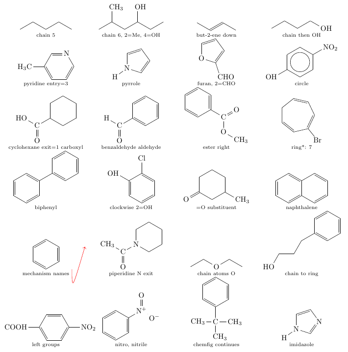

# chemfrag — ready-made rings, chains and functional groups for chemfig

Version 1.0.1 (2026-11-25)

`chemfrag` adds building blocks to [chemfig](https://ctan.org/pkg/chemfig):
rings, zigzag chains and functional groups. A fragment is not a picture but a
chemfig *submolecule* that turns into ordinary chemfig code. You keep writing
`\chemfig{...}` as before and drop fragments in wherever they help. You can
continue in hand-written chemfig after any fragment, and attach fragments to
any hand-written structure.

```latex
\usepackage{chemfrag}   % loads chemfig

\chemfig{!{benzene*}{2=NO_2, 4=Cl}-[::0]!{OH}}          % 2-nitro-4-chlorophenol
\chemfig{H_3C-!{benzene*}{exit=4}-[::0]!{carboxyl}}     % p-toluic acid
\chemfig{!{chain}{6, 2=CH_3, 4=OH}}                     % 5-methylhexan-3-ol
\chemfig{!{pyridine*}{entry=3}-[::0]!{carboxyl}}        % nicotinic acid
```



## Features

- **27 rings** (`benzene`, `cyclohexane`, `pyridine`, `furan`, `pyrrole`,
  `piperidine`, …), plus `!{ring*}{size=7, bonds=...}` for any ring.
  Options: substituents by position, exit atom, entry numbering, clockwise
  numbering, aromatic circle, heteroatoms, bond patterns, atom names for
  `\chemmove`.
- **Chains**: `!{chain}{5, 2=CH_3, double=3}`, zigzag in any direction.
- **Functional groups**: condensed (`!{OH}` reads `HO` when it sits on the left)
  and skeletal (`!{carboxyl}`, `!{ester}`, `!{amide}`, `!{nitro}`, …).
- `\chemfragset{...}` for defaults, `\chemfragdefinering{...}` for your own
  rings.
- Works with babel languages that make `!` or `:` active (French, …).

See `chemfrag-doc.pdf` for the manual.

## Requirements

LaTeX 2022-06-01 or later and chemfig 1.6 or later.

## Installation

Install from your TeX distribution once the package is on CTAN, or copy
`chemfrag.sty` and `chemfrag-*.code.tex` into your `TEXMFHOME`
(`texmf/tex/latex/chemfrag/`). With l3build: `l3build install`.

## Development

```
l3build check     # regression tests (pdfTeX and LuaTeX)
l3build doc       # builds chemfrag-doc.pdf
l3build ctan      # builds chemfrag-ctan.zip
```

Layout: `tex/` (package code), `doc/` (manual), `testfiles/` (tests),
`build.lua` (l3build configuration).

## Bugs and ideas

Please open an issue at <https://github.com/vaibhavblayer/chemfrag/issues>.

## License

Copyright (C) 2026 Vaibhav Blayer.

This work may be distributed and/or modified under the conditions of the
LaTeX Project Public License, version 1.3c or later:
<https://www.latex-project.org/lppl.txt>. This work has the LPPL maintenance
status "maintained". The Current Maintainer of this work is Vaibhav Blayer.
